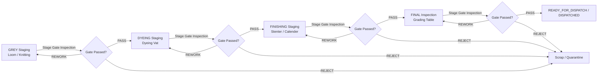

# LoomIQ Module 4 — Stage Quality Gates & Quality Control Tower

## 1. Overview & Architecture

LoomIQ Module 4 implements server-enforced, multi-stage quality gates, an early-detection Quality Control Tower, and a closed-loop Corrective Action (CAPA) tracking workflow for textile mills.

Quality is checked **after every production process stage** so defects are identified and resolved where they are generated, rather than escaping undetected to final inspection or customer shipment.

> [!IMPORTANT]
> **Deterministic Intelligence Guarantee:** All verdicts, metrics (FPY, RTY, escape rates), and alerts are computed purely from deterministic arithmetic and formal rule evaluation over verified inspection records. LoomIQ **never** utilizes black-box prediction or unexplainable heuristics for quality verdicts.

---

## 2. Stage Quality Pipeline & Thresholds

| Stage | Process Description | Machine Types | Pass Max (pts/100m) | Rework Max (pts/100m) | Max Reworks |
|---|---|---|---|---|---|
| `GREY` | Greige fabric weaving / knitting | `loom`, `knitting_machine` | **20.0** | **40.0** | **2** |
| `DYEING` | High-temperature vat dyeing & scouring | `dyeing_vat` | **15.0** | **30.0** | **2** |
| `FINISHING` | Stenter heat-setting & finishing range | `finishing_range` | **10.0** | **20.0** | **2** |
| `FINAL` | Visual grading & packaging | *(None / grading table)* | **8.0** | **15.0** | **2** |

> [!NOTE]
> All thresholds, defect catalogs, and scoring weights are configured as demo presets in `backend/src/config/qualityStages.config.js`. In production, these parameters map to mill-specific Standard Operating Procedures (SOPs) or ASTM D5430 4-Point System standards.

---

## 3. Defect Scoring & Verdict Rules

### 3.1 Severity Weights
Defect points are scored per occurrence:
- **MINOR**: `1 point`
- **MAJOR**: `3 points`
- **CRITICAL**: `5 points`

### 3.2 Points per 100 Metres Formula
$$\text{Defect Points} = \sum (\text{Quantity}_i \times \text{Weight}_i)$$

$$\text{Points Per 100m} = \frac{\text{Defect Points}}{\text{Roll Quantity (metres)}} \times 100$$

### 3.3 Evaluation Decision Tree
1. **Critical Rule:** If any defect has severity `CRITICAL` (with quantity > 0), recommended verdict is immediately **`REJECT`**.
2. **Rework Limit Rule:** If prior reworks at this stage $\ge 2$ and points/100m > pass limit, recommended verdict is **`REJECT`** (rework limit reached).
3. **Pass Rule:** If points/100m $\le \text{passMax}$, recommended verdict is **`PASS`**.
4. **Rework Rule:** If points/100m $\le \text{reworkMax}$, recommended verdict is **`REWORK`**.
5. **Reject Rule:** If points/100m $> \text{reworkMax}$, recommended verdict is **`REJECT`**.

### 3.4 Inspector Overrides
- **Stricter Overrides** (e.g. recommended `PASS` $\rightarrow$ overridden to `REWORK` or `REJECT`): Permitted unconditionally.
- **Lenient Overrides** (e.g. recommended `REWORK` $\rightarrow$ overridden to `PASS`, or `REJECT` $\rightarrow$ `REWORK`/`PASS`): Strictly require `isOverride: true` and an explainable `overrideReason` of **at least 10 non-whitespace characters** (e.g., concession waiver, QA manager approval).

---

## 4. Stage Progression & Dispatch Constraints

- **Stage Advancement (`POST /api/rolls/:rollId/advance`):**
  - Requires roll's current `qualityStatus` to be `PASS`.
  - Rolls at `PENDING`, `REWORK`, or `REJECT` are blocked (`409 GATE_NOT_PASSED`).
  - Next-stage machine selection must match the valid machine type for that stage (e.g. `dyeing_vat` for `DYEING`). Mismatches return `422 MACHINE_TYPE_MISMATCH`.
  - Transition closes the previous stage history entry (`exitedAt: timestamp`) and opens a new history entry, resetting roll status to `PENDING` for the new stage gate.
- **Dispatch Constraint (`PATCH /api/rolls/:rollId/dispatch`):**
  - A roll **cannot** transition to `READY_FOR_DISPATCH` or `DISPATCHED` unless it is at stage **`FINAL`** with `qualityStatus: PASS`. Upstream stages are blocked (`409 GATE_NOT_PASSED`).

---

## 5. Quality Control Tower & Early Detection Metrics

The Quality Control Tower (`/quality`) provides real-time factory-wide analytics computed dynamically on request:

1. **First-Pass Yield (FPY):**
   $$\text{FPY}_{\text{stage}} = \frac{\text{First-pass PASS count}}{\text{Total first-pass inspections at stage}} \times 100\%$$
   *(Requires $\ge 5$ first-pass inspections; displays "Low sample (n < 5)" otherwise).*
2. **Rolled Throughput Yield (RTY):**
   $$\text{RTY} = \prod_{s \in \text{stages}} \text{FPY}_s$$
   *(Calculated when all 4 stages meet minimum sample size; provides plain-language explanation).*
3. **Late-Detection Rate & Escapes:**
   - **Defect Escape:** An inspection finding a defect whose catalog origin stage is earlier than the inspecting stage (e.g. weaving slub caught at FINAL inspection).
   - **Late Detection Rate:** $\frac{\text{Rejects at FINAL}}{\text{Total Rejects Across All Stages}} \times 100\%$
4. **Defect Pareto:** Ranked list of defects across the factory by occurrence count and total severity points with cumulative percentage curve.
5. **Machine Hotspots:** Workcenters ranked by non-pass rate during first-pass inspection with top defect breakdown.

---

## 6. Rule-Based Quality Alerts

Alerts are evaluated dynamically over production records:

| Alert Code | Severity | Trigger Rule | Suggested Action |
|---|---|---|---|
| `MACHINE_DEFECT_RATE` | `CRITICAL` / `WARN` | Machine non-pass rate $\ge 50\%$ (CRITICAL) or $\ge 30\%$ (WARN) over $\ge 5$ first-pass inspections | Inspect mechanical alignment, tension guides, and calibration on workcenter. |
| `INSPECTION_OVERDUE` | `WARN` | Roll has been in stage without inspection for $> 4.0$ hours (SLA breach) | Dispatch quality inspector immediately to examine roll at staging area. |
| `REWORK_LIMIT` | `CRITICAL` | Roll has reached maximum reworks ($2$) at current stage and remains non-pass | Perform scrap assessment or initiate quarantine deviation approval. |
| `RECURRING_DEFECT` | `WARN` | Machine produced $\ge 3$ occurrences of the same defect in the last 14 days | Open or review Corrective Action (CAPA) to eliminate root cause. |

---

## 7. Closed-Loop Corrective Actions (CAPA)

The Corrective Actions system (`/quality/actions`) tracks root-cause resolution:

1. **Identifier Format:** `CA-<YYYY>-<4-digit>` (e.g., `CA-2026-0001`), generated from an atomic counter.
2. **Lifecycle State Machine:**
   $$\text{OPEN} \longrightarrow \text{IN\_PROGRESS} \longrightarrow \text{DONE} \longrightarrow \text{VERIFIED}$$
   *(DONE actions can be reopened to IN_PROGRESS. VERIFIED is terminal and requires a `verificationNote`).*
3. **Automated Post-Fix Recurrence Tracker:**
   When an action is marked `DONE`, the system tracks all subsequent inspections on the target machine for the specified `defectCode`. If matching defects occur after `doneAt`, the action shows a prominent warning with recurrence counts and affected roll IDs.

---

## 8. API Reference

| Endpoint | Method | Description |
|---|---|---|
| `/api/quality/config` | `GET` | Get stage metadata, defect catalogs, severity weights, and demo rules |
| `/api/quality/summary` | `GET` | Get Control Tower analytics (FPY, RTY, Pareto, hotspots, hold list) |
| `/api/quality/alerts` | `GET` | Get active rule-based quality alerts sorted by severity |
| `/api/rolls/:rollId/inspection/preview` | `POST` | Calculate points, trace, and recommended verdict without saving |
| `/api/rolls/:rollId/inspection` | `PATCH` | Record stage gate inspection with optional override validation |
| `/api/rolls/:rollId/advance` | `POST` | Advance roll to next stage with machine assignment |
| `/api/corrective-actions` | `GET` | List corrective actions with filters (status, stage, machine, overdue) |
| `/api/corrective-actions` | `POST` | Create new CAPA action |
| `/api/corrective-actions/:actionNumber` | `GET` | Get CAPA action detail with live recurrence analysis |
| `/api/corrective-actions/:actionNumber` | `PATCH` | Update CAPA status, root cause, owner, or verification note |
